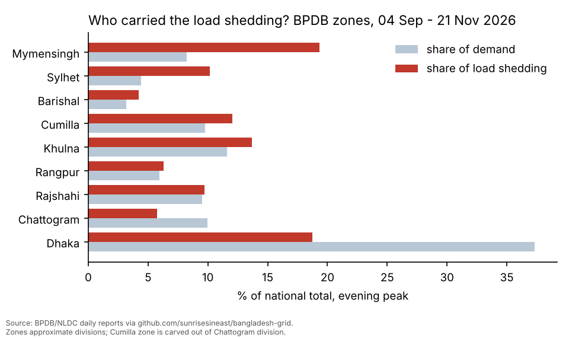

# Cold Chain in the Dark

**Did Bangladesh's 2026 power cuts weaken its measles vaccination campaign?**

In 2026 Bangladesh lived through two crises at once. The country's largest
recorded measles outbreak, by 13 September, had reached 170,638 suspected and
20,006 confirmed cases, with 919 deaths among suspected cases
([CDC *Emerging Infectious Diseases*, 2026](https://wwwnc.cdc.gov/eid/article/32/11/26-1019)).
At the same time, gas supply fell to a 16-year low in July-August and daily
load shedding passed 3,500 MW. Dhaka was kept comparatively stable while rural
Bangladesh absorbed most of the cuts
([ISAS, 2026](https://www.isas.nus.edu.sg/papers/bangladeshs-power-crisis-energy-vulnerability-and-political-consequences/)).

Measles-rubella vaccine has to stay cold from the district store to the
child's arm. A nationwide MR campaign started on 20 April 2026, but cases kept
rising for months afterwards. This project asks one question:

> **Did districts that lost more power during the campaign see relatively more
> measles once vaccine protection should have started?**

As far as we could find, nobody has linked the two crises with data. A GitHub
search in November 2026 for "vaccine cold chain bangladesh" and for
"measles power outage" returned no repositories.

---

## What is in this repository

| Part | What it does | Status |
|---|---|---|
| `scripts/01_fetch_dghs.py` | District-level daily measles counts from the public DGHS platform API | ready to run |
| `scripts/02_fetch_bpdb.py` | Zone-wise load shedding parsed from BPDB daily PDF reports | ready to run |
| `gee/export_district_ntl_temperature.js` | NASA Black Marble night lights (outage proxy) + ERA5-Land max temperature, per district per night | ready to run in Earth Engine |
| `scripts/03_prepare_ntl.py` | Combines the Earth Engine exports | ready to run |
| `scripts/04_run_analysis.py` | Panel build, difference-in-differences, event study, placebo, robustness | **tested on synthetic data** |
| `scripts/05_zone_inequality.py` | Who carried the load shedding, by BPDB zone | **run on real data**, see below |
| `app/dashboard.py` | Streamlit dashboard | working |
| `tests/` | 20 tests, including recovery of a planted effect | passing |
| `docs/pre_analysis_plan.md` | Hypotheses, design and threats, **written before seeing the outcome data** | done |

## First real result: who carried the load shedding

From 78 daily BPDB/NLDC reports (4 September - 21 November 2026), in
`results/zone_inequality/`:



- **Dhaka zone** had 37% of evening-peak demand but 19% of the load shedding
  (burden ratio 0.50).
- **Mymensingh** had 8% of demand but 19% of the load shedding (ratio 2.34),
  and **Sylhet** had 4% of demand but 10% of the load shedding (ratio 2.30).

These numbers show that the burden of the power cuts was unequal. That is the
reason to measure outages district by district before asking what they did to
the vaccines.

## Study design (short version)

* **Unit:** 64 districts x weeks, 13 April - 27 September 2026.
* **Outcome:** weekly suspected measles cases (lab-confirmed as a check), with
  the under-5 population as the offset.
* **Exposure:** mean night-light outage index during the campaign window,
  standardised across districts. The index measures how much darker the
  normally-lit pixels were than in December-February.
* **Model:** Poisson fixed-effects difference-in-differences,
  `cases ~ district FE + week FE + post x exposure + post x pre-campaign attack rate`,
  with standard errors clustered by district. The coefficient is reported as a
  rate ratio per +1 SD of outage.
* **Checks:** an event study for pre-trends; a placebo that uses outages
  *before* the campaign; a "horse race" with both windows in one model; a
  negative binomial fit; deep-outage and hot-outage variants; BPDB zone data
  as an independent exposure; the night-light proxy validated against BPDB
  zone load shedding.

The pipeline has been tested end to end on synthetic data with a planted rate
ratio of 1.25. It recovers 1.26 (95% CI 1.23-1.29), and it returns about 1.0
when no effect is planted (`results/synthetic_demo/`, clearly stamped
SYNTHETIC).

## Run it

```bash
git clone https://github.com/<you>/cold-chain-in-the-dark && cd cold-chain-in-the-dark
python -m venv .venv && source .venv/bin/activate      # Windows: .venv\Scripts\activate
pip install -r requirements.txt
pytest                                                  # 20 tests

python scripts/05_zone_inequality.py                    # real data, included
python scripts/04_run_analysis.py --synthetic           # pipeline demo

# the real study
python scripts/01_fetch_dghs.py                         # ~30-60 min
python scripts/02_fetch_bpdb.py
#   run gee/export_district_ntl_temperature.js in code.earthengine.google.com,
#   put the CSVs from Google Drive into data/raw/gee/
python scripts/03_prepare_ntl.py
python scripts/04_run_analysis.py
streamlit run app/dashboard.py
```

There is a step-by-step guide in Bengali in [`docs/SETUP_bn.md`](docs/SETUP_bn.md).

## Honest limitations

* This is an observational study. Rural districts lose more power *and* face
  many other disadvantages. District fixed effects, the placebo and the
  horse-race model address this, but they cannot rule it out completely.
* VIIRS passes over at about 01:30 local time. The night-light proxy sees
  outages at that hour only; the BPDB zone data covers the evening peak.
* Monsoon clouds remove many nights. Nights where fewer than 30% of the lit
  pixels are cloud-free are dropped, and the number of usable nights is
  reported for each district.
* The DGHS platform starts on 10 April, so there is only a short pre-campaign
  period for checking trends.
* Health facilities may have had generators or solar-powered fridges. If they
  did, any effect would be smaller and harder to detect.

## Data sources and credit

See [`THIRD_PARTY_NOTICES.md`](THIRD_PARTY_NOTICES.md). The approach to the
DGHS platform API follows Kath Sherratt's
[measles-bgd](https://github.com/kathsherratt/measles-bgd) (MIT). The BPDB
PDF parser is vendored from
[bangladesh-grid](https://github.com/sunrisesineast/bangladesh-grid) (MIT).

## License

Code: MIT. Downloaded data keeps its original terms; raw downloads are not
committed to this repository.
